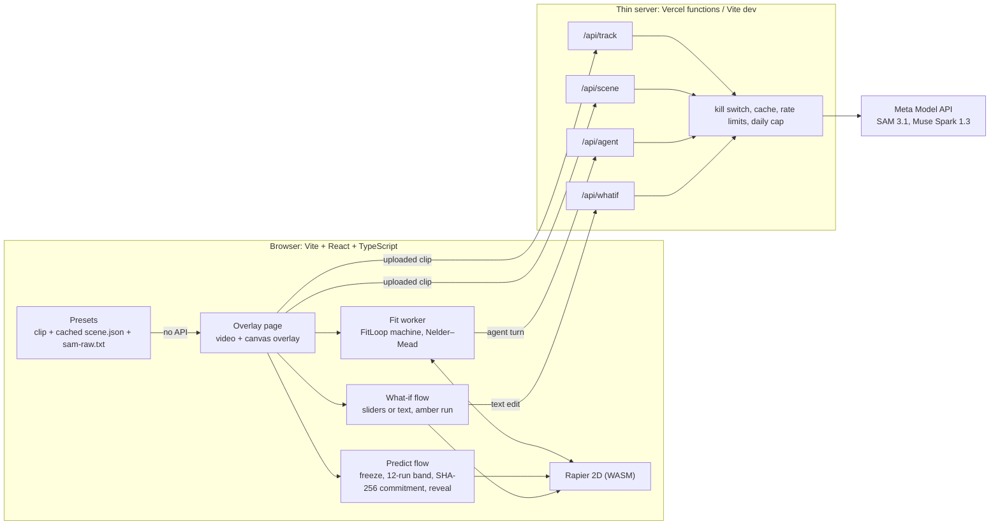

# Physics Twin

Film one second of a ball rolling down a ramp. Physics Twin turns the clip into a 2D physics simulation, tunes the simulation's friction and bounce until it matches the footage, then freezes the clip and predicts where the ball goes next, as a band, with a hash of the prediction shown before the rest of the clip plays. Then it reports how far off it was, in cm, px and ms. You can also ask "what if the ramp were steeper, or the block gone?" and the same frozen frame plays the new future.

Narrow on purpose: a 2D, side-on, rigid-body tabletop scene, with an error number every time.

## Demo video

**Video: link to come** (3:00). Every scene in it is **synthetic**: drawn from the simulation with known parameters, not filmed, and labelled that way on screen. The SAM 3.1 and Muse Spark calls in it are live calls, made on Nov 3 on those synthetic scenes ([docs/live-calls.md](docs/live-calls.md)).

## Built during the event

Everything in this repository was built during the Meta Global AI Developer Hackathon, **Oct 27 – Nov 4, 2026**: the first commit is Oct 27, 22:05 JST, and each day's work is one pull request (Day 1 to Day 6). Nothing was forked or copied from another repository; the libraries used are the npm packages in `package.json`.

## Try it

`npm ci && npm run dev`, then open the page and press a preset (**A** baseline, **B** steeper ramp, **C** block removed). Presets need no API key. Then **Fit on the first 1.0 s**, **Freeze and predict**, **Reveal**, and under the result, the **What if** panel.

The three presets are **synthetic for now**: no real takes were on the build machine when they were made, so they are drawn from the simulation with known parameters, and the page says so on each one. [docs/presets.md](docs/presets.md) has their results and how to swap in real takes.

## What each model does

| Model | Role here | Where |
|---|---|---|
| **SAM 3.1** (`sam-3.1`, Meta Model API) | Tracks the ball and the blocks through the whole clip, prompted with boxes on frame 0 so the object IDs are ours. Its boxes, per frame, are the measurement: the fit's loss and the reveal's ground truth. Parsed with `@meta-sam/parser`. | `/api/track`, `src/tracks/` |
| **Muse Spark 1.3**, grounding (`muse-spark-1.3`) | Reads frame 0 into a typed scene (ramp ends, table line, blocks, ball, the two tape marks 50 cm apart), strict structured output, checked with zod. The tape marks give the scale; the scene becomes Rapier bodies. | `/api/scene`, `src/scene/` |
| **Muse Spark 1.3**, fitting agent | Each iteration it reads the best run's error per segment (ramp, flight, bounce, roll), may call a `simulate` tool, then proposes parameters with a one-line reason for the log. Nelder–Mead fine-tunes from each proposal. If the agent fails, the fit says so and carries on numeric-only. | `/api/agent`, `src/agent/`, `src/fit/` |
| **Muse Spark 1.3**, what-if editor | Turns "what if the ramp were twice as steep and the blue block gone?" into a typed scene edit (strict structured output, zod-checked, impossible edits refused). The sliders make the same edits without the model. | `/api/whatif`, `src/whatif/` |
| **Rapier 2D** (`@dimforge/rapier2d-compat`, WASM; not a Meta model) | The physics: a deterministic 240 Hz simulation of the scene, run thousands of times per fit and 12 times per prediction. | `src/sim/` |

The browser never holds the API key: the four routes run on the thin server (Vite dev server locally, Vercel functions when deployed). See [docs/server.md](docs/server.md).

## Architecture



Every flow with three or more states is a typed XState machine with transition tests: AppFlow, FitLoop, clip intake, predict, what-if (`src/machines/`). The fit only ever receives the first 1.0 s after the release; tests replace everything after it with nonsense and check that the fit, its log and every byte sent to the model are unchanged ([docs/fit.md](docs/fit.md)).

## Every take's error

**Real takes: pending.** The final takes (filming guide sets A, B, C, ten each) were not on the build machine by day 6, so there is no real error table yet. When they are, `npm run results -- <folder> --track` and `npm run whatif -- <folder>` write the full tables (every take, mean and worst per set, every take left out and why) to `<folder>/results/`, and they go here unedited.

Until then, everything below is **synthetic**: simulated takes with known parameters, put through the same parser, fit, prediction and scoring as a real take. They show the pipeline is honest and how close it gets when the physics model is right; they say nothing about real footage.

Prediction, every synthetic take (day 4, set A, five sets of true parameters; [docs/predict.md](docs/predict.md)):

| Take | True μ ramp, e | Event | Error cm / px / ms | Inside band | Trajectory RMS mm |
|---|---|---|---|---|---|
| A01 | 0.08, 0.55 | turnaround | 0.15 / 1.7 / 0.0 | yes | 19.1 |
| A02 | 0.03, 0.45 | horizon | 2.09 / 24.1 / — | yes | 10.6 |
| A03 | 0.12, 0.70 | turnaround | 0.12 / 1.3 / 0.1 | yes | 14.9 |
| A04 | 0.05, 0.30 | turnaround | 0.15 / 1.8 / 0.2 | yes | 7.3 |
| A05 | 0.10, 0.60 | turnaround | 0.15 / 1.7 / −0.1 | yes | 16.7 |
| A06 | (video only) | excluded: not tracked | | | |

The three presets ([docs/presets.md](docs/presets.md)):

| Preset | Event | Error cm / px / ms | Inside band |
|---|---|---|---|
| A baseline | turnaround (block hit) | 0.18 / 2.1 / 0.0 | yes |
| B steeper, 38° | horizon at 2.0 s | 4.50 / 51.8 / — | **no** |
| C block removed | horizon at 1.27 s | 1.48 / 17.0 / — | yes |

What-if against counterfactual takes (day 5; [docs/whatif.md](docs/whatif.md)), every baseline × every counterfactual:

| Set | Pairs | Landing error cm (mean / worst) | Landing time error ms (mean / worst) | Trajectory RMS mm (mean / worst) |
|---|---|---|---|---|
| B (38°) | 9 | 0.10 / 0.16 | 1.2 / 1.6 | 21.3 / 23.4 |
| C (no block) | 9 | 0.30 / 0.66 | 2.7 / 5.6 | 2.3 / 2.7 |

The miss on preset B and the 21 mm RMS on what-if B have the same cause, listed under limits.

Live Meta API runs on preset A's synthetic clip (day 7, [docs/live-calls.md](docs/live-calls.md)): with the live Muse Spark fitting agent, the prediction landed inside the band, 0.20 cm / 2.3 px off. With the live Muse Spark scene and a live SAM 3.1 track as well, it landed **outside**, 1.10 cm / 12.7 px off, because Spark read the ramp about 4 cm off (27.0° against 29.4°).

## Limits

- **2D, side-on camera, rigid objects**, 1–5 of them (ball, ramp, blocks, table), and two tape marks a known distance apart in the ball's plane. No 3D, no live camera, nothing soft.
- **The first second fixes μ ramp and bounce, not table friction.** μ table and rolling damping are held at 0.3 and 0.2, and the 12-run band spreads only μ ramp and e. A long roll on the table (preset B, after the block hit) can end outside the band; the page says so in red.
- Rapier has no rolling resistance, so rolling loss is a damping term.
- **The live Meta Model API has run only on synthetic clips** (day 7, about 82 calls, [docs/live-calls.md](docs/live-calls.md)). All four routes work. On a flat-shapes frame Muse Spark put the ramp ends about 4 cm off, and SAM 3.1 prompted from Spark's ball box tracked the ramp; prompted with a box on the ball, it held the ball on every frame. How either does on real footage is untested. The presets and everything after loading a clip work without the API.
- The deployed site takes uploads of at most 4.5 MB (Vercel's request limit), so the 240 fps originals cannot be tracked there; the presets need no upload. The dev server takes up to 50 MB.
- The thin server's cache and limits live in memory, per warm instance: they stop a loop or a curious visitor from spending credits, not a determined one. The kill switch turns every route off.

## Run it

```sh
npm ci
npm run dev          # the page, with the thin server on /api (MODEL_API_KEY from the shell or .env.local)
npm test             # 500+ tests: machines, fitter, no-peeking, determinism, server, presets
npm run typecheck && npm run lint
npm run build && PHYSICS_TWIN_API_OFF=1 npm run preview   # the production build, API off, as deployed
```

Scripts: `npm run smoke:sam` / `smoke:spark` (one live call each, [docs/smoke.md](docs/smoke.md)), `npm run synthetic` (a synthetic take), `npm run fit` (fit one take from the terminal), `npm run results` (every take's prediction error), `npm run whatif` (every what-if against the counterfactual takes), `npm run presets` (rebuild or swap the presets).

## Deploying on Vercel

The repo deploys as is: `vercel.json` builds the Vite site to `dist/` and the four `api/*.ts` files become functions. Set these in the Vercel project's environment variables:

| Variable | To turn the API on | Meaning |
|---|---|---|
| `MODEL_API_KEY` | **required**, mark it sensitive | Meta Model API key. Without it every route answers 503 and the site runs on presets. |
| `PHYSICS_TWIN_API_OFF` | unset (or `0`) | `1` is the kill switch: every route answers 503, presets only. |
| `PHYSICS_TWIN_DAILY_CAP` | optional | Calls that may reach the API per UTC day, all routes together (default 400). |
| `META_API_BASE_URL` | leave unset | Only for pointing the server at a local mock of the API. |

## Docs

Day by day: [smoke](docs/smoke.md) (day 1), [overlay](docs/overlay.md) (day 2), [fit](docs/fit.md) (day 3), [predict](docs/predict.md) (day 4), [what-if](docs/whatif.md) and [server](docs/server.md) (day 5), [presets](docs/presets.md) (day 6), [live calls](docs/live-calls.md) (day 7).

## License

MIT, see [LICENSE](LICENSE).
